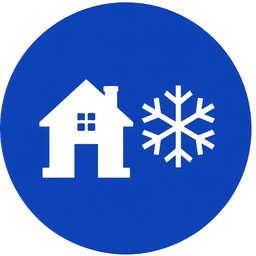

# Écoles fermées Québec

<p align="center">
  
</p>

Intégration Home Assistant pour suivre les fermetures d’écoles au Québec (tempêtes, transport, etc.) via l’API JSON de [TVA Nouvelles](https://www.tvanouvelles.ca/etat-ecoles-fermees).

À l’installation, vous cherchez une école puis la sélectionnez. Chaque école devient un appareil avec ses capteurs. Pour une 2e ou 3e école, ajoutez l’intégration une autre fois.

[](https://github.com/hacs/integration)
[](https://github.com/djiesr/ha-ecoles-fermees-quebec/releases)
[](https://github.com/djiesr/ha-ecoles-fermees-quebec/actions/workflows/validate.yml)

[](https://my.home-assistant.io/redirect/hacs_repository/?owner=djiesr&repository=ha-ecoles-fermees-quebec&category=integration)

## Installation

### Via HACS (recommandé)

1. Ouvrez HACS dans Home Assistant.
2. Allez dans **Integrations**.
3. Menu ⋮ → **Custom repositories**.
4. Ajoutez `https://github.com/djiesr/ha-ecoles-fermees-quebec` avec la catégorie **Integration**.
5. Cherchez **Écoles fermées Québec** et installez-la.
6. Redémarrez Home Assistant.

Ou cliquez le badge HACS ci-dessus depuis un navigateur déjà connecté à votre instance.

### Manuel

1. Téléchargez le zip de la [dernière release](https://github.com/djiesr/ha-ecoles-fermees-quebec/releases).
2. Extrayez le contenu dans `custom_components/ecoles_fermees_quebec/`.
3. Redémarrez Home Assistant.

## Configuration

1. **Paramètres → Appareils et services → Ajouter une intégration**
2. Cherchez **Écoles fermées Québec**
3. Entrez le nom de l’école ou la ville
4. Choisissez l’école dans la liste

Pour une autre école : **Ajouter une intégration** une nouvelle fois.

## Capteurs par école

| Entité | Rôle |
| --- | --- |
| `binary_sensor.*_fermee` | Allumé si l’école est fermée (idéal pour les automatisations) |
| `sensor.*_statut` | `Ouverte` / `Fermée` |
| `sensor.*_message` | Message TVA, s’il y en a un |
| `sensor.*_details` | Ex. « Cours suspendus », « Pas de transport pour la journée » |
| `sensor.*_derniere_mise_a_jour` | Horodatage TVA |

Le binaire expose aussi `message`, `informations`, `css`, `start` et `end` en attributs.

Les données sont rafraîchies toutes les **5 minutes**. Une seule requête TVA est partagée entre toutes les écoles ajoutées.

## Automatisation d’exemple

```yaml
alias: École fermée
triggers:
  - trigger: state
    entity_id: binary_sensor.ecole_xxx_fermee
    to: "on"
actions:
  - action: notify.mobile_app
    data:
      title: École fermée
      message: "{{ state_attr('binary_sensor.ecole_xxx_fermee', 'message') }}"
```

## Notes

Cette API n’est pas officielle. TVA peut la modifier ou la retirer. La source officielle reste le centre de services scolaire de l’école (site, Facebook, boîte vocale).
